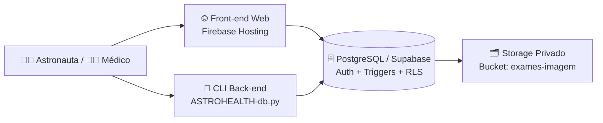

<div align="center">

<!-- BANNER SUPERIOR ANIMADO (ONDA AZUL, ROSA & BRANCO) -->


<!-- TYPING SVG DINÂMICO -->
<a href="https://spaceapps2026-infinitygirls.web.app/">
  
</a>

<br/>

<!-- BADGES TEMÁTICOS AZUL, ROSA & BRANCO -->
[](https://www.spaceappschallenge.org/)
[](https://spaceapps-infinitygirls.web.app/)
[](#-equipe-infinity-girls)
[](db/schema.sql)
[](ASTROHEALTH-db.py)


[🌌 Sobre a Missão](#-sobre-a-missão) •
[🎨 Identidade Visual](#-identidade-visual-azul--branco) •
[✨ Funcionalidades](#-funcionalidades-principais) •
[🏗️ Arquitetura](#️-arquitetura-do-sistema) •
[📂 Estrutura do Repositório](#-Estrutura-do-Repositório) •
[🚀 Como Executar](#-como-executar-o-projeto) •
[👩‍🚀 Equipe](#-equipe-infinity-girls)

</div>

<!-- DIVISOR ANIMADO -->


## 🌌 Sobre a Missão

🌌 Sobre a Missão
O AstroHealth é uma plataforma interativa de monitoramento biomédico e autogestão de saúde desenvolvida pela equipe **Infinity Girls** para o **NASA Space Apps Challenge 2026** (Create Health Monitoring Software for Astronauts on Space Missions) para garantir a autonomia da tripulação em missões espaciais de longa duração (como missões lunares do programa Artemis ou viagens a Marte). 

Em expedições de espaço profundo — como o programa **Artemis** na Lua ou missões tripuladas a **Marte** — a comunicação com a Terra sofre atrasos de até **44 minutos** (ida e volta). O AstroHealth capacita a tripulação a registrar sinais vitais, realizar autoavaliações anatômicas, enviar exames de imagem e receber protocolos médicos imediatos com **baixa carga cognitiva** e total autonomia.

---

### 🛰️ Mitigação dos 5 Riscos dos Voos Espaciais Tripulados (NASA HRP)

| Risco Espacial (NASA) | Impacto Fisiológico | Solução Integrada no AstroHealth |
| :--- | :--- | :--- |
| 🪐 **Campos Gravitacionais** | Alterações cardiovasculares, perda óssea e enjoo na troca de gravidade | Monitoramento de pressão arterial, FC, nutrição (Vitamina D / Cálcio) e escala vestibular |
| ☣️ **Radiação Espacial** | Alterações imunológicas e estresse celular | Registro periódico de marcadores imunes salivares e cetonas |
| 🏠 **Ambiente Fechado Hostil** | Desidratação, desequilíbrio nutricional e qualidade do habitat | Controle de calorias, proteínas, hidratação diária e contexto da missão (`base` / `rover`) |
| 🧠 **Isolamento e Confinamento** | Oscilações de humor, estresse e distúrbios do sono | Check-in diário privado de humor/estresse (1–5) e gamificação individual sem exposição pública |
| 📡 **Distância da Terra** | Impossibilidade de telemedicina síncrona em emergências | Triggers automáticos no banco de dados para alertas críticos e protocolos autônomos offline-first |

---

## 🎨 Identidade Visual (Azul & Branco)

A interface foi projetada com alto contraste e ergonomia visual espacial, priorizando tons profundos de **Azul** e tipografia em **Branco Puro** para leitura instantânea sem fadiga ocular:

<div align="center">

| Amostra | Token | Código HEX | Aplicação na Interface |
| :---: | :--- | :---: | :--- |
|  | **Deep Space Navy** | `#030F26` | Fundo principal do painel e estrutura da estação |
|  | **NASA Cobalt Blue** | `#0B3D91` | Cabeçalhos, bordas estruturais e identidade institucional |
|  | **Telemetry Cyan** | `#00D2FF` | Botões primários, hotspots anatômicos e sinais vitais normais |
|  | **Starlight White** | `#FFFFFF` | Textos principais, valores biométricos e ícones de alto contraste |

</div>

---

## ✨ Funcionalidades Principais

* 🧍 **Body Check-in Interativo:** Modelo anatômico clicável por região (cabeça, tórax, abdômen, membros) para registro rápido de sintomas, intensidade (1 a 5) e exibição imediata de protocolos de primeiros socorros.
* 📈 **Telemetria & Exames Laboratoriais:** Monitoramento contínuo de Frequência Cardíaca (`bpm`), Pressão Arterial (`mmHg`), Oxigenação (`SpO₂`), Glicose (`mg/dL`), Cetonas, Cortisol Salivar e Nutrição por ambiente (`nave`, `estacao`, `lua_base`, `lua_rover`, `marte_base`, `marte_rover`).
* 🚨 **Triggers Automáticos de Anomalia:** Gatilho SQL (`verificar_anomalia_vital`) que analisa cada leitura inserida e dispara alerta crítico automaticamente quando `SpO₂ < 95%`, `FC > 110 bpm`, `FC < 50 bpm` ou `PA > 180 mmHg`.
* 🩺 **Exames de Imagem & Prontuário Médico:** Upload de ultrassom venoso e OCT de retina para bucket privado (`exames-imagem`), com acesso restrito ao oficial médico (`eh_medico()`) para laudo e emissão de parecer clínico.
* 👁️ **Prevenção SANS & Saúde Mental:** Acompanhamento diário de humor, estresse, adaptação gravitacional e contramedidas da Síndrome Neuro-Ocular Associada ao Voo Espacial (suplementação de Complexo B e uso de manguito de coxa).
* 🏆 **Gamificação Privada da Rotina:** Metas diárias de hidratação (`2.500 ml`), exercícios resistidos e sono com desbloqueio de conquistas individuais sem exposição competitiva entre tripulantes.

---
## 🏗️ Arquitetura do Sistema


---
## 📂 Estrutura do Repositório

```text
NASA/
├── app/                      # Aplicação Front-end Web (Aplicativo de monitoramento dos astronautas)
│   ├── assets/               # Recursos visuais, ícones e estilos da interface
│   ├── pages/                # Páginas e telas do painel biomédico
│   ├── tests/                # Testes automatizados (Playwright)
│   ├── tools/                # Utilitários e scripts auxiliares do front-end
│   ├── index.html            # Ponto de entrada da aplicação web
│   ├── package.json          # Dependências e scripts Node.js
│   ├── playwright.config.js  # Configuração da suíte de testes E2E
│   └── sw.js                 # Service Worker (suporte offline-first para missões espaciais)
├── db/
│   └── schema.sql            # DDL completo: tabelas, triggers, função eh_medico(), RLS e Storage
├── ASTROHEALTH-db.py         # Back-end Python integrado ao Supabase (Painel Astronauta & Médico)
├── requirements.txt          # Dependências Python (supabase, python-dotenv)
├── .env.example              # Modelo de variáveis de ambiente para configuração local
├── .gitignore                # Proteção contra versionamento de credenciais (.env)
├── .gitattributes            # Configuração de atributos e normalização do Git
├── LICENSE                   # Licença MIT do projeto
└── README.md                 # Documentação oficial do projeto
```
---
## 🚀 Como Executar o Projeto

### Passo a Passo

1. **Clone o repositório:**
   ```bash
   git clone 
   [https://github.com/seu-usuario/astrohealth.git](https://github.com/seu-usuario/astrohealth.git)
   cd astrohealth
2. Instale as dependências do Front-end:
    ```bash
    cd frontend
    npm install
3. Execute o projeto em ambiente local:
    ```bash
    # No terminal do backend
    python main.py

    # No terminal do frontend
    npm run dev
    ```
4. Acesse a aplicação no seu navegador: https://spaceapps2026-infinitygirls.web.app/

--- 
### 🤝 Como Contribuir

Contribuições são bem-vindas! Se você deseja propor melhorias:

1. Faça um Fork do projeto.

2. Crie uma Branch para sua funcionalidade (git checkout -b feature/nova-funcionalidade).

3. Abra um Pull Request.

---
## 👩‍🚀 Equipe Infinity Girls

| Avatar | Nome | Função / Especialidade | Redes & Contato |
| :---: | :--- | :--- | :---: |
|  | **Elisa Soares** | Data Engineer | [](https://github.com/elisaosoares0) [](https://linkedin.com/in/elisasoarestech) |
|  | **Jeniffer Tavares** | Ajustar | [](https://github.com/jennyttavares-dotcom) [](https://www.linkedin.com/in/jeniffer-tavares-2a0852a6/i/) |
|  | **Lara Moura** | Ajustar | [](https://github.com/laramour) [](https://www.linkedin.com/in/laranogueirabsi/) |
|  | **Rafaela Protasio** | QA Enginner | [](https://github.com/elisaosoares0) [](https://linkedin.com/in/rafaela-protasio) |
|  | **Thaiza Favarelli** | Frontend Developer & Ergonomics | [](https://github.com/itstfs) [](https://www.linkedin.com/in/thaiza-favarelli-da-silva/) |
|  | **Yasmin Abdon** | Ajustar | [](https://github.com/yaabdon) [](https://linkedin.com/in/yasminabdon) |

---
## 📄 Licença
Este projeto é desenvolvido sob a licença MIT — consulte o arquivo LICENSE para mais detalhes.

