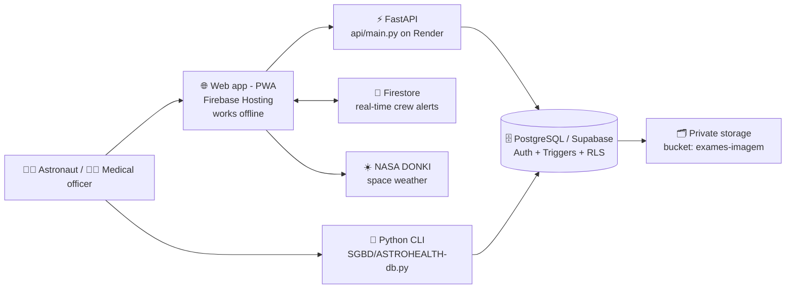

<div align="center">

<!-- TOP BANNER: the project's light theme palette (Electric Blue → Deep Blue, the official NASA Space Apps gradient) -->


<!-- TYPING LINE -->
<a href="https://spaceapps2026-infinitygirls.web.app/">
  
</a>

<br/>

[](https://www.spaceappschallenge.org/)
[](https://spaceapps2026-infinitygirls.web.app/)
[](#-team-infinity-girls)
[](#-accessibility)

[](app/)
[](api/)
[](SGBD/schema.sql)
[](app/tests/)
[](LICENSE)

[The story](#-the-story) •
[What it does](#-what-it-does) •
[Brand and design system](#-brand-and-design-system) •
[How we built it](#-how-we-built-it) •
[Tools](#-tools-and-technologies) •
[Architecture](#-system-architecture) •
[Repository](#-repository-structure) •
[Team](#-team-infinity-girls) •
[Licenses](#-licenses-and-credits)

</div>


## 🌌 The story

### The problem

On the International Space Station, a doctor on Earth can answer a question in seconds. On a mission to the Moon or to Mars, this is not possible. A message to Mars and its answer can take up to **44 minutes**. The crew cannot come back quickly, and the spacecraft carries a limited supply of medicine.

So the crew must take care of their own health, every day, with very little time. Today, astronaut health data is spread across many systems, and a large part of it is typed by hand. Some needs get little attention, like the health of women in space: the menstrual cycle, contraception, bone loss and the risk of blood clots.

Our challenge was **"Create Health Monitoring Software for Astronauts on Space Missions"** of the NASA Space Apps Challenge 2026.

### Our answer: Astro Health

**Astro Health** is a web app that helps each crew member understand their health and act on it, alone if necessary.

Meet Commander Silva, on day 120 of a long mission. She wakes up and the app already shows her **readiness score**, measured by her smart shirt during the night. One reading is in yellow, so the app tells her in plain words what to do and how to return to normal. She feels pain in her lower back, so she touches the back of the **3D astronaut** on the screen, picks the symptom and its intensity, and the app gives her the right protocol. A message reminds her to take vitamin D at 08:00 UTC.

Later, a crew member collapses. Silva presses **SOS**. The app speaks the steps out loud, one at a time, shows where everyone is in the habitat, and sends an alert to the medical officer's device in real time. The doctor answers "I'm on my way". All of this works **without a connection to Earth**.

### Built for the 5 hazards of human spaceflight (NASA Human Research Program)

| NASA hazard | What it does to the body | How Astro Health helps |
| :--- | :--- | :--- |
| 🪐 **Altered gravity** | Changes in the heart and blood vessels, bone loss, motion sickness | Blood pressure and heart rate, nutrition (vitamin D and calcium), bone density charts and a nausea mode |
| ☣️ **Space radiation** | Damage to cells and to the immune system | Cumulative radiation dose against the career limit, and live space weather from NASA DONKI |
| 🏠 **Hostile closed environment** | Dehydration, poor nutrition, poor sleep | Daily goals for water, exercise and sleep, and the context of the mission (station, base or rover) |
| 🧠 **Isolation and confinement** | Changes in mood, stress and sleep problems | A private daily check-in of mood and stress, and personal achievements without public ranking |
| 📡 **Distance from Earth** | No real-time help from doctors on Earth | Offline-first app, SOS with voice guidance, emergency guides and real-time crew alerts |

## ✨ What it does

* 💙 **Readiness ring:** one score for the day, made from eight vital signs. Each sign says its status in text, with an icon, never with color alone.
* 🧑‍🚀 **3D astronaut:** a NASA spacesuit model. Touch a sensor dot to see a vital sign and its 24-hour line. Touch a body region to log a symptom and its intensity (1 to 5).
* 🩸 **Blood glucose:** a guided reading, typed or received from a Bluetooth glucometer, with clear steps when the value is low or high.
* 🫀 **Ultrasound:** the astronaut sends a vein scan, and the medical officer writes a review.
* 🎯 **Daily goals and check-in:** water, exercise, sleep and a private mood check-in, with a streak and achievements.
* ♀️♂️ **Women's and men's health:** cycle plan, contraception supply, a private daily diary, bone health, blood clot warning signs, and eye health (SANS) checks.
* 💬 **"Ask" assistant:** answers questions with the person's own data and with the guides in the app. It quotes its sources and works offline.
* 🚨 **SOS:** voice guidance step by step, a metronome for chest compressions, the habitat map and a real-time alert to the crew.
* 🩺 **Medical officer panel:** the status of each crew member, open alerts with decision guides, pre-flight exams and scan reviews.
* 🗓️ **Mission phases:** the app changes before, during and after the flight, so each person only sees what they can act on.
* 📶 **Offline-first:** a service worker keeps the whole app on the device. Health records are saved on the device first and are sent to the server when there is a connection.

## 🎨 Brand and design system

The visual identity follows the **[NASA Space Apps brand guidelines](https://www.spaceappschallenge.org/brand/)** (a copy is in [`app/pesquisas/brand.pdf`](app/pesquisas/brand.pdf)). This is the light theme palette, the default of the app:

<div align="center">

| Sample | Name | HEX | Where we use it |
| :---: | :--- | :---: | :--- |
|  | **Electric Blue** | `#0042A6` | Primary color: links, filled buttons, selected tab |
|  | **Deep Blue** | `#07173F` | Text, footer, the end of the hero gradient |
|  | **Neon Blue** | `#0960E1` | Charts and the focus ring |
|  | **Blue Yonder** | `#2E96F5` | Accents and charts (never text on white) |
|  | **Neon Yellow** | `#EAFE07` | A small highlight only, never a background |
|  | **Rocket Red** | `#E43700` | Lines and charts only, never a background |
|  | **Martian Red** | `#8E1100` | Critical status and form errors |
|  | **White** | `#FFFFFF` | Cards and the page |

</div>

**Brand rules we follow**

* Every pair of text and background has a contrast of at least **4.5:1**.
* There is **one gradient** only: linear, from Electric Blue (top left) to Deep Blue (bottom right), at 45°.
* **Typography:** Fira Sans (Black and Bold) for headings and Overpass (Regular, Bold and Italic) for text. Both fonts are free and are stored in the project.
* **Icons:** [Phosphor Icons](https://phosphoricons.com/), the icon set that the brand guide suggests. A symbol is used only when its meaning is clear. Otherwise, we write a text label.
* **Team decision:** the dark theme uses neutral black and dark gray backgrounds, like most websites, and keeps the brand blues for the details.

**Design system**

* One component for each job, inspired by the Apple Human Interface Guidelines: sheets, lists, segmented controls, icon buttons, cards and chips. We used Framework7 and Ionic only as references, not as dependencies.
* Design tokens for color, spacing (an 8 px grid), type, icon sizes and motion.
* Small animations made with Lottie, for example when a task is done. They are decoration only, and they stop when the device asks for reduced motion.
* A live **Design system** page inside the app shows every component, its states and its code.

## 🛠️ How we built it

### 🔬 Research
We started with research, not with screens. We read NASA papers about astronaut health, medical autonomy on the Moon and Mars, and the differences between men and women in space. We organized the research in 13 steps on FigJam: goals, users and stakeholders, benchmark, technologies, UX questions, information gaps and opportunities. A coverage analysis compares each research finding with what the app does. Everything is in [`app/pesquisas/`](app/pesquisas/).

### ♿ Accessibility
* We follow **WCAG 2.2 level AA**. Automated tests with **axe-core** check every page in the light and dark themes, and the result must be zero violations.
* Touch targets are at least 48 × 48 px. The whole app works with a keyboard, and the focus is always visible.
* Color never carries meaning alone: status always has an icon and a word. Every chart has a text summary and a data table.
* Changes are announced to screen readers with `aria-live`. The 3D astronaut has a text alternative with shortcuts for each body region.
* **Reduced motion** is respected. A **nausea mode** makes the screen simpler for a crew member with motion sickness.

### 🧭 Usability
* Every screen follows the **10 usability heuristics of Jakob Nielsen**. For example, the status of the system is always visible, and a "Watch" status always says how to return to normal.
* The app shows only what the person can act on in the current mission phase.
* Temporary notices go to a "Health messages" chat and never cover the page.

### 🖥️ Front-end
* **Vanilla JavaScript, HTML and CSS**, without a UI framework, so the app is light and fast.
* CSS classes follow **BEM**. Colors, spaces and sizes come only from design tokens.
* A **service worker** makes the app work offline (a Progressive Web App).

### 🗄️ Back-end and database
* **PostgreSQL on Supabase**, with authentication, triggers that detect dangerous vital signs, and a private storage bucket for scans.
* **Row Level Security (RLS):** an astronaut sees only their own data, and the medical officer sees the data of the crew.
* A **FastAPI** service connects the app to the database. The front-end saves each record on the device first and sends it to the API when there is a connection.
* **Firestore** carries the real-time crew alerts between devices.

### ✅ Quality assurance
* **Playwright** end-to-end tests run on a phone size (414 px) and a desktop size (1280 px). They cover sign-in, vital signs, the 3D astronaut, emergencies with two devices, sync with the server, the design system and accessibility.
* A manual test plan is in [`docs/qa/`](docs/qa/). Bugs found in tests were reported as GitHub issues.

### 🔐 Security and privacy
* The app uses only the **public key** of Supabase. The database rules (RLS) decide who can read each row.
* Secrets stay in `.env` files, which are never committed.
* **Emergency guidance is deterministic.** The voice assistant reads fixed protocols with the measured values. No language model decides what to do in an emergency.
* Each astronaut controls who can see their data. In an emergency, only the location and the vital signs of that alert are shared with the crew.

### ⚡ Performance and optimization
* The goal is a **PageSpeed score of 90 or more** on mobile and desktop.
* Libraries are stored in the project (no CDN) and load late: Three.js only for the 3D astronaut, Firebase only in flight, and the Lottie player only when an animation plays.
* Fonts use WOFF2, the 3D model uses Draco compression, and the production build minifies CSS, JavaScript and HTML.

### 🧩 Code architecture
* Each feature is a small module on the global `App` object, for example `App.records`, `App.sync` and `App.charts`.
* Health records use the same table and column names as the database, so the front-end and the back-end speak the same language.
* One script ([`app/tools/chrome.js`](app/tools/chrome.js)) writes the header, the footer and the shared scripts on every page, so they never differ.

## 🧰 Tools and technologies

| Area | Tools |
| :--- | :--- |
| Front-end | HTML, CSS (BEM), Vanilla JavaScript, Service Worker (PWA) |
| 3D and motion | Three.js, Draco, lottie-web |
| Icons and fonts | Phosphor Icons, Fira Sans, Overpass |
| Back-end | Python, FastAPI, Uvicorn, HTTPX |
| Database and auth | PostgreSQL, Supabase (Auth, RLS, Storage) |
| Real-time alerts | Firebase Firestore |
| Hosting | Firebase Hosting (app), Render (API) |
| NASA data | DONKI (space weather), NASA 3D Resources |
| Tests | Playwright, axe-core |
| Build | esbuild, Node.js |
| Design and research | Figma, FigJam, Trello |

## 🏗️ System architecture



## 📂 Repository structure

```text
Infinity_Girls/
├── api/                      # FastAPI service between the app and Supabase
│   ├── main.py               # Routes: sign-in, vital signs, scans, check-ins, goals, records
│   ├── regras.py             # Validation rules and readable error messages
│   ├── supabase_rest.py      # Small client for the Supabase REST APIs
│   ├── tests/                # Tests of the rules
│   └── README.md             # How to run the API
├── app/                      # The web app (Astro Health)
│   ├── assets/               # Shared CSS (design tokens), JavaScript modules, fonts, images, 3D model, data
│   ├── brand/                # NASA Space Apps logos, patterns and the mascot
│   ├── pages/                # One folder per page: vitals, body, learn, profile, emergency, design system...
│   ├── pesquisas/            # Research: NASA papers, UX research, brand guide, coverage analysis
│   ├── tests/                # Playwright end-to-end and accessibility tests
│   ├── tools/                # Build, header and footer generator, local server, vendor and animation scripts
│   ├── index.html            # Home page (sign-in, astronaut home, medical officer panel)
│   ├── sw.js                 # Service worker for offline use
│   ├── firebase.json         # Firebase Hosting configuration
│   ├── firestore.rules       # Firestore security rules for crew alerts
│   └── package.json          # Scripts and pinned dependencies
├── SGBD/                     # Database
│   ├── schema.sql            # Tables, triggers, RLS policies and functions
│   ├── ajustes_api.sql       # Adjustments for the API
│   ├── storage_bucket.sql    # Private bucket for scans
│   ├── ASTROHEALTH-db.py     # Python CLI for the astronaut and the medical officer
│   └── demo_video_usuario2.py # Live database demo script
├── docs/qa/                  # Manual test plan
├── LICENSE                   # MIT License
└── README.md                 # This file
```

## ▶️ Run it locally

```bash
# Web app
cd app
npm install
npm run serve        # http://localhost:8080
npm test             # Playwright tests (phone and desktop sizes)

# API (optional)
cd api
pip install -r requirements.txt
uvicorn main:app --reload --port 8000
```

The API needs a `.env` file with the Supabase URL and public key. See [`api/README.md`](api/README.md).

## 👩‍🚀 Team Infinity Girls

| Avatar | Name | Role | Links |
| :---: | :--- | :--- | :---: |
|  | **Thaiza Favarelli** | Front-end Developer & Software Engineer | [](https://github.com/itstfs) [](https://www.linkedin.com/in/thaiza-favarelli-da-silva/) |
|  | **Jeniffer Tavares** | UX Research, UX/UI Design, Front-end & Testing | [](https://github.com/jennyttavares-dotcom) [](https://www.linkedin.com/in/jeniffer-tavares-2a0852a6/) |
|  | **Elisa Soares** | Back-end, Database & Front-end Integration | [](https://github.com/elisasoares0) [](https://linkedin.com/in/elisasoarestech) |
|  | **Yasmin Abdon** | Back-end, Database & Front-end Integration | [](https://github.com/yaabdon) [](https://linkedin.com/in/yasminabdon) |
|  | **Lara Moura** | Research, Project Management (Trello) & Space Apps Project Description | [](https://github.com/laramour) [](https://www.linkedin.com/in/laranogueirabsi/) |
|  | **Rafaela Protasio** | QA Testing & Issue Reporting | [](https://github.com/Rafa-Protasio) [](https://linkedin.com/in/rafaela-protasio) |

## 📄 Licenses and credits

**Project.** The source code of Astro Health is under the [MIT License](LICENSE).

**NASA data and resources**

| Resource | Use in the app | Terms |
| :--- | :--- | :--- |
| [DONKI](https://kauai.ccmc.gsfc.nasa.gov/DONKI/) (Space Weather Database Of Notifications, Knowledge, Information), through [api.nasa.gov](https://api.nasa.gov/) | Live solar particle events and coronal mass ejections | NASA open data |
| [NASA Human Research Program](https://www.nasa.gov/hrp/) | The 5 hazards and the risks on the Learn page | NASA public content |
| [NASA Office of the Chief Health and Medical Officer](https://www.nasa.gov/ochmo/) | The career radiation limit on the dose card | NASA public content |
| [NASA 3D Resources](https://github.com/nasa/NASA-3D-Resources): Extravehicular Mobility Unit | The 3D spacesuit on the home page | [NASA Images and Media Usage Guidelines](https://www.nasa.gov/nasa-brand-center/images-and-media/) |

**Brand.** The NASA Space Apps logos, colors, patterns and fonts follow the [NASA Space Apps brand guidelines](https://www.spaceappschallenge.org/brand/). The Astro Health logo and mascot were made by the team.

**Libraries, icons and fonts**

| Name | Use | License |
| :--- | :--- | :--- |
| [Three.js](https://threejs.org/) | 3D astronaut | MIT |
| [Draco](https://google.github.io/draco/) | Compressed 3D model | Apache 2.0 |
| [lottie-web](https://github.com/airbnb/lottie-web) | Micro-interactions (animations made by the team) | MIT |
| [Firebase JavaScript SDK](https://firebase.google.com/) | Real-time crew alerts with offline cache | Apache 2.0 |
| [Phosphor Icons](https://phosphoricons.com/) | Interface icons | MIT |
| [Fira Sans](https://fonts.google.com/specimen/Fira+Sans) and [Overpass](https://fonts.google.com/specimen/Overpass) | NASA Space Apps brand fonts | SIL Open Font License |
| [FastAPI](https://fastapi.tiangolo.com/), [Uvicorn](https://www.uvicorn.org/), [HTTPX](https://www.python-httpx.org/) | API | BSD-3-Clause |
| [Playwright](https://playwright.dev/), [axe-core](https://github.com/dequelabs/axe-core), [esbuild](https://esbuild.github.io/) | Tests and build (development only) | Apache 2.0, MPL 2.0, MIT |

**Disclaimer.** Astro Health is a prototype made for the NASA Space Apps Challenge 2026. It uses simulated health data. **It is not a medical device** and it does not replace a doctor.

<div align="center">


</div>
